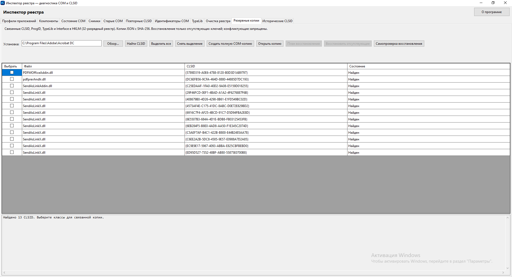
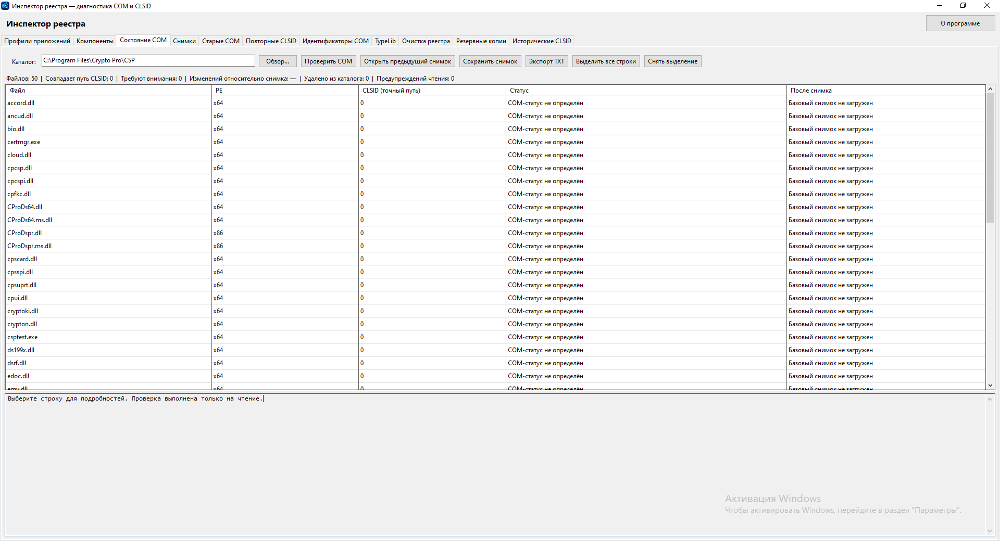
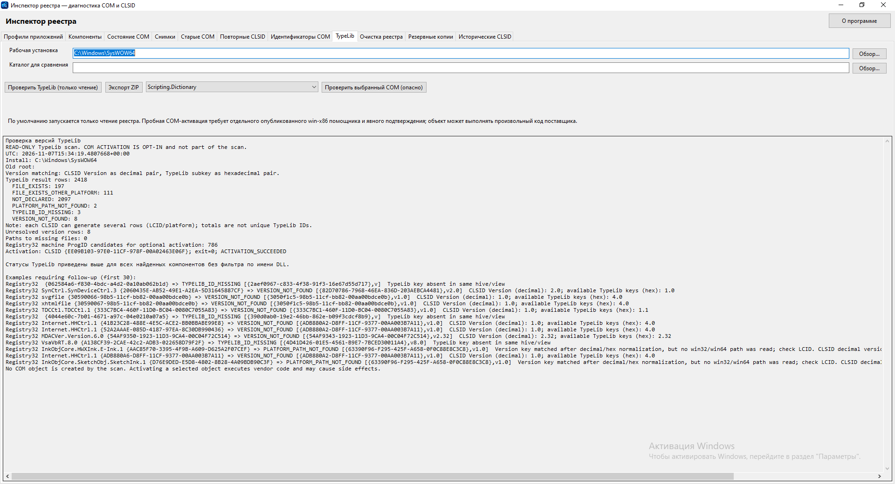
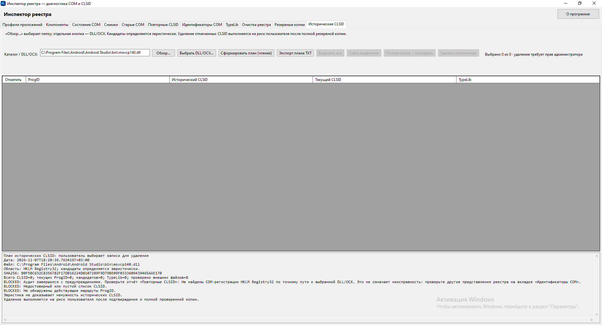
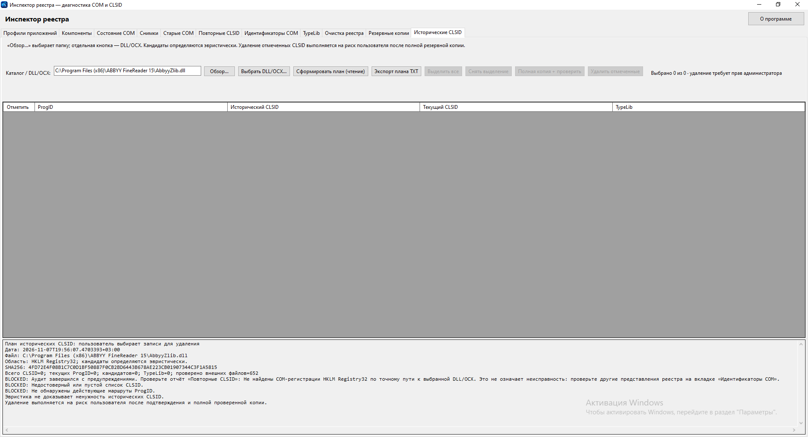

# RegistryInspector

**RegistryInspector** — настольное приложение для Windows, предназначенное для диагностики COM-регистраций и обслуживания связанных записей реестра. Программа помогает исследовать CLSID, ProgID, TypeLib и Interface, проверять состояние COM-компонентов, формировать отчёты и работать с резервными копиями.

**Версия:** `0.6.0 RC2` · **Статус:** предварительный релиз (Pre-release) · **Платформа:** Windows x64

[**Скачать RegistryInspector 0.6.0 RC2**](https://github.com/RomanLarichev/portfolio/releases/tag/registryinspector-v0.6.0-rc2) · [Все релизы](https://github.com/RomanLarichev/portfolio/releases)

## Возможности

- **Диагностика COM:** проверка файлов в выбранном каталоге, CLSID и путей регистрации, просмотр состояния компонентов.
- **Идентификаторы COM:** анализ связей CLSID, ProgID, TypeLib и Interface, включая 32-битное представление реестра.
- **Исторические и повторные CLSID:** формирование диагностических планов для выбранных DLL/OCX, оценка возможных устаревших записей, экспорт результатов.
- **TypeLib:** чтение регистрационных сведений, проверка согласованности версий и путей.
- **Проверка COM-активации:** отдельная операция по явному подтверждению. Для проверки 32-битных COM-компонентов используется встроенный x86-помощник.
- **Резервное копирование:** сохранение связанных COM-записей, проверка копий и восстановление отсутствующих ключей в предусмотренных программой сценариях.
- **Обслуживание реестра:** управляемая очистка выбранных записей с подтверждением и предварительным резервированием.
- **Профили приложений и отчёты:** сохранение параметров анализа, экспорт диагностических данных в поддерживаемые форматы.

## Скриншоты

### Резервные копии COM-регистраций

Поиск связанных CLSID и подготовка полной COM-копии выбранного приложения.

### Состояние COM-компонентов

Анализ файлов и COM-состояния в каталоге установленного приложения.

### TypeLib и проверка COM-активации

Чтение реестра и отдельная проверка активации: в диагностическом отчёте зафиксирован результат `ACTIVATION_SUCCEEDED`. Проверка выполнялась на установленном компоненте Windows.

### Исторические CLSID

Построение диагностического плана для конкретной DLL/OCX. Отсутствие найденных кандидатов — допустимый результат; оно само по себе не свидетельствует об ошибке.

Дополнительный пример анализа DLL/OCX

## Технологии и архитектура

- **C# / .NET 8 / Windows Forms** — пользовательский интерфейс и логика приложения.
- **Windows Registry и COM** — диагностика регистрационных сведений и связей между компонентами.
- **x64 + встроенный x86-помощник** — поддержка проверки активации 32-битных COM-компонентов через отдельный процесс, автоматически запускаемый приложением.
- **Самодостаточная публикация** — для пользователя распространяется один `RegistryInspector.exe`, без отдельной установки .NET Runtime.

## Установка и запуск

1. Откройте [релиз RC2](https://github.com/RomanLarichev/portfolio/releases/tag/registryinspector-v0.6.0-rc2).
2. Скачайте `RegistryInspector.exe` из раздела **Assets**.
3. Запустите приложение в Windows x64.
4. Выберите каталог приложения или DLL/OCX в соответствующей вкладке и выполните диагностику.

Операции чтения не требуют удаления или изменения регистрационных данных. Для отдельных операций записи в реестр могут потребоваться права администратора.

## Ограничения и безопасность

> [!WARNING]
> Удаление или восстановление COM-записей может нарушить работу установленного ПО. RegistryInspector предоставляет диагностические данные, резервное копирование и подтверждение операций, но не гарантирует, что выбранный CLSID не используется другими программами. Решение о внесении изменений принимает пользователь.

- Обнаруженный «исторический» CLSID не обязательно является ненужным.
- Некоторые диагностические функции анализируют конкретное представление реестра (например, `HKLM Registry32`); отсутствие записей в нём не исключает регистрацию в других представлениях.
- Проверка COM-активации запускает код проверяемого компонента; выполнять её следует только для доверенных объектов.
- Проект находится на стадии **Release Candidate**. Сборка и отдельные сценарии проверялись в Windows; это не подтверждение совместимости со всеми программами и конфигурациями.

## Статус релиза

**RC2:** подтверждены сборка одного самодостаточного EXE без предупреждений, запуск интерфейса и успешная проверка 32-битной COM-активации. На предоставленных примерах выполнены диагностика TypeLib, просмотр COM-состояния, поиск связанных CLSID и формирование планов для исторических записей.

[Перейти к RegistryInspector 0.6.0 RC2](https://github.com/RomanLarichev/portfolio/releases/tag/registryinspector-v0.6.0-rc2)

---

*RegistryInspector — независимый диагностический инструмент. Не является продуктом или официальной утилитой сторонних разработчиков программного обеспечения.*
